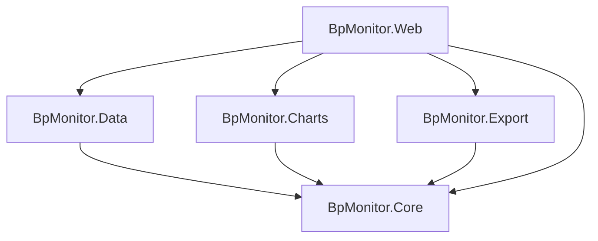

# Architecture: Blood Pressure Monitor

## Solution Structure

```text
code/
├── BpMonitor.slnx
├── BpMonitor.Core           # Domain models, interfaces, business logic
├── BpMonitor.Core.Tests     # Unit tests for Core
├── BpMonitor.Data           # EF Core + SQLite, repository implementations
├── BpMonitor.Data.Tests     # Integration tests for Data
├── BpMonitor.Charts         # Plotly.NET chart generation
├── BpMonitor.Charts.Tests   # Snapshot tests for Charts
├── BpMonitor.Export         # JSON and CSV serialization and file write
├── BpMonitor.Export.Tests   # Tests for Export
├── BpMonitor.Web            # Falco web app (server-rendered pages, auth, export, health)
├── BpMonitor.Web.Tests      # Tests for Web layer
├── BpMonitor.Web.E2E.Tests  # Playwright .NET browser smoke tests (real out-of-process app + Chromium/Firefox)
├── BpMonitor.Arch.Tests     # ArchUnit tests enforcing Clean Architecture rules
├── BpMonitor.Benchmarks     # BenchmarkDotNet suite (e.g. LOWESS reference vs. sliding window); local only
└── BpMonitor.TestSupport    # Shared test infrastructure (Verify snapshot settings, domain record builders, E2E process-readiness polling) for *.Tests projects
```

## Tech Stack

| Concern | Decision |
| --- | --- |
| Solution format | `.slnx` (new XML-based format, VS 2022 17.10+) |
| Language / Runtime | F# on .NET 11 |
| Web Framework | Falco 5 + Falco.Markup (server-rendered F# HTML) |
| Web interactivity | htmx (vendored, no build step) |
| Logging | Serilog.AspNetCore — structured logs to stdout (configured in `appsettings.json`), captured by `podman logs` / journald |
| Database | SQLite + EF Core |
| Charting | Plotly.NET — generates interactive HTML; plotly.js vendored locally (extracted from Plotly.NET's embedded resource via `scripts/extract-plotly-js.fsx`, no CDN) |
| Validation | `FsToolkit.ErrorHandling` — applicative validation with `Validation<'ok, 'err>` |
| Architecture | Clean Architecture (Core has zero dependencies on other projects) |
| Architecture tests | ArchUnit (via `BpMonitor.Arch.Tests`) |
| E2E tests | Playwright .NET (via `BpMonitor.Web.E2E.Tests`) — one shared out-of-process `BpMonitor.Web` instance and one Chromium + one Firefox browser for the whole assembly; each test class gets its own family member for isolation, not its own app |
| Test runner | xUnit v3 on Microsoft.Testing.Platform (MTP) — all 7 test projects run in parallel via `dotnet test` (default `--max-parallel-test-modules` = CPU count) |
| Test coverage | `Microsoft.Testing.Extensions.CodeCoverage` — Cobertura output, one file per test project |
| Benchmarks | BenchmarkDotNet in `BpMonitor.Benchmarks`, run locally with `mise run bench` (not in CI); `Lowess.Reference` is the baseline for `Lowess.smooth` |
| Snapshot testing | `Verify.XunitV3` — SponsorCheck is silenced via the maintainer's free open-source exemption in `code/Directory.Build.props`; re-attest by bumping `Verify_SponsorshipExemptionUntil` (currently **2027-09**) when it's reached |

## Data Model

```fsharp
// BpMonitor.Core
type FamilyMember = {
    Id:           int
    Name:         string
    IsAdmin:      bool
    IsActive:     bool
    Credential:   Credential      // Password hash | PendingSetup (setup code hash) | NoCredential — see ADR 0012
    Goal:         GoalRange       // per-member systolic/diastolic chart goal range
    Language:     Language        // per-member UI language (English | German)
    CreatedAt:    DateTimeOffset
    ModifiedAt:   DateTimeOffset
}

type GoalRange = {
    SystolicMin:  int
    SystolicMax:  int
    DiastolicMin: int
    DiastolicMax: int
}
// GoalRange.defaults = { 90; 140; 60; 90 } — preset from Wegier et al. 2021
// (docs/resources/12911_2021_Article_1598.pdf, Fig. 3)

type BloodPressureReadingUnvalidated = {
    Systolic:  int
    Diastolic: int
    HeartRate: int
    Timestamp: DateTimeOffset
    Comments:  string option
}

type BloodPressureReading = {
    Id:         int
    MemberId:   int           // which family member this reading belongs to
    Systolic:   int
    Diastolic:  int
    HeartRate:  int
    Timestamp:  DateTimeOffset
    Comments:   string option
    CreatedAt:  DateTimeOffset
    ModifiedAt: DateTimeOffset
}

type ValidationError =
    | SystolicOutOfRange  of int
    | DiastolicOutOfRange of int
    | HeartRateOutOfRange of int

type Medication = {
    Id:         int
    MemberId:   int
    Name:       string          // short label shown on the timeline row — "HCTZ"
    FullName:   string option   // long form, hover tooltip — "hydrochlorothiazide"
    Comment:    string option
    StartDate:  DateOnly
    EndDate:    DateOnly option // None = ongoing
    CreatedAt:  DateTimeOffset
    ModifiedAt: DateTimeOffset
}

type MedicationError =
    | NameIsEmpty
    | EndDateBeforeStartDate
```

## Dependency Diagram



## Project Responsibilities

### BpMonitor.Core

- `Language` — `English | German`, `Language.all`/`defaultLanguage`/`nativeName`/`tryParse`/`code` (ISO 639-1)
- `LocalizedStrings` — all user-facing text, one record per language (`LocalizedStrings.en`; `LocalizedStrings.forLanguage`); nested area records (`Shell`, `Table`, `Login`, `Reading`, `Member`, `Medication`, `Trend`, `Errors`, `Charts`) so the compiler enforces every language supplies every field — see ADR 0008 for why this was chosen over `.resx`
- Domain models: `BloodPressureReading`, `BloodPressureReadingUnvalidated`, `FamilyMember` (carries `Language`), `Medication`
- Repository interfaces: `IReadingRepository` (member-scoped), `IFamilyMemberRepository`, `IMedicationRepository` (member-scoped)
- `Medication.parse` — applicative validation (name non-empty, end date on/after start date); `Medication.overlapping from until` — filters to medications whose `[StartDate, EndDate]` interval intersects a date window (ongoing medications, `EndDate = None`, always match forward)
- `FamilyMember.hasActiveAdmin` — invariant: ≥1 member with `IsAdmin = true` and `IsActive = true`
- `FamilyMember.isClaimed` — true when `Credential` is `Password`
- `GoalRange` — per-member systolic/diastolic chart goal range; `GoalRange.defaults` (90–140 / 60–90) and `GoalRange.create` (enforces min < max for each pair)
- `PasswordHashing` — PBKDF2-SHA256 hash/verify
- `SetupCode` — one-time claim codes (ADR 0012): `generate` (`XXXX-XXXX`, no look-alike characters), `hash`/`verify` (case, dashes and spaces ignored), `issueMissing` (codes for `NoCredential` members, run at startup)
- `ReadingStats` — date-window filter, AHA 2017 BP classification, windowed summary
- `TrendPeriod.Label` is a `PeriodLabel` DU (`ThisWeek`, `CalendarWeek of int`, `MonthOfYear of int * int`, …), rendered via `LocalizedStrings.Trend` at the view layer rather than as English prose in Core
- `DemoData` — deterministic Simpson-family fixture generator (fixed seed, ~5 years of readings)
- Applicative validation via `FsToolkit.ErrorHandling`; no dependencies on other projects

### BpMonitor.Data

- EF Core `DbContext`: `Readings` (`ReadingRecord`), `Members` (`MemberRecord`), `Medications` (`MedicationRecord`)
- SQLite with WAL mode + 5 s busy timeout
- `IReadingRepository`: `EfReadingRepository` (filters by `MemberId`), `InMemoryReadingRepository`
- `IFamilyMemberRepository`: `EfFamilyMemberRepository`, `InMemoryFamilyMemberRepository`
- `IMedicationRepository`: `EfMedicationRepository` (filters by `MemberId`), `InMemoryMedicationRepository`
- `SchemaMigrations.apply` — manual migrations (EF Core migrations don't support F#); `ensureActiveAdmin` promotes lowest-Id member when no active admin exists; creates the `Medications` table on legacy databases
- `DemoSeeder.seedIfEmpty` — seeds Simpson-family data (from `DemoData` in Core) when `BpMonitor:SeedDemoData=true` and the store is empty; idempotent; Ned Flanders additionally gets a demo medication timeline (an ongoing HCTZ + a completed lisinopril course)

### BpMonitor.Charts

- Plotly.NET chart generation — `BpChart.toHtml` (history), `toHtmlRecent` (Recent view), `toHtmlDashed` (trends); each takes a `ChartStrings` so legend/axis text is localized
- `BpChart.toHtmlMedications` — the Medications Timeline (Wegier et al. 2021 Fig. 5): one bar per medication on a date axis aligned with the BP chart; returns `""` for no medications
- Medication colors come from a stable hash of the name into an 8-slot palette, so a medication keeps its color across pages; each trace carries its light and dark color for `theme.js` to swap
- Returns HTML fragments embedded by the Web handlers
- `GoalRange` renders a translucent band per series in that series' color — the "like-with-like" design from Wegier et al. 2021, Fig. 3
- Depends on Core only

### BpMonitor.Export

- JSON and CSV serialization of readings (`JsonExport`, `CsvExport`), served by Web at `/export` and `/export.csv`
- Depends on Core only

### BpMonitor.Web

- Falco web application on `0.0.0.0:5000`; server-rendered HTML via `Falco.Markup`, htmx for partial updates, scoped `DbContext` per request
- **Auth:** ASP.NET Core cookie auth with per-member PBKDF2-SHA256 passwords; unclaimed members claim their account with a one-time setup code (ADR 0012). The cookie carries a credential stamp that is re-checked on every request, so deactivation, admin changes and password resets take effect immediately. `protect` / `protectAdmin` combinators guard routes
- **Cookie policy:** `SameSite=Lax` (not `Strict`) so links opened from other apps keep the session. "Remember me" makes the cookie persistent for `BpMonitor:RememberMeDays`, sliding. Data Protection keys persist under `BpMonitor:DataProtectionKeyPath`, otherwise every container redeploy invalidates the cookie
- **Isolation:** each member sees only their own readings; admins manage members via `/members` but not their readings
- **Routes:** `/` hub, `/add`, `/readings*`, `/history`, `/recent` (+ `/recent/full`), `/trends*`, `/settings` (+ `/settings/language`), `/medications*`, `/members*`, `/export`, `/export.csv`, `/login*`, `POST /logout`, anonymous `GET /health`
- **Language:** `LocalizedStrings` is resolved per request from the member's `Language` → `bpmonitor_lang` cookie → `Accept-Language` → `BpMonitor:DefaultLanguage` → English, as an explicit function call rather than `RequestLocalizationMiddleware` (ADR 0008)
- **`/health`:** `200`/`503` depending on `Database.CanConnect()`; the container health check runs `dotnet BpMonitor.Web.dll --healthcheck` (`HealthProbe.fs`) because the chiseled image has no shell or curl
- **`/settings`:** the member's own goal range and medications (CRUD in `MedicationHandlers.fs`), as collapsible sections whose open state `details-memory.js` remembers
- **Medications Timeline:** a collapsible panel below the BP chart on `/recent` and `/history` (not `/trends`, whose x-axis isn't dates); `medications-sync.js` keeps its x-axis and scrubber in sync with the BP chart
- **`/recent`:** loads the last 365 days and focuses the chart on the last 30; a Fig. 5-style value strip above the chart color-codes each value against the member's `GoalRange`. "Load full history" swaps in a chart of the entire history (`/recent/full`)
- **`/trends`:** Weekly/Monthly/Yearly periods with stats from `ReadingStats`; `TimeProvider` injected for testability
- **Version footer:** `Version.current` reads `AssemblyInformationalVersion` — `dev` for local builds, `v1.2.3` for releases

### BpMonitor.Arch.Tests

- ArchUnit rules enforcing Clean Architecture layer boundaries: Core ↛ Data/Charts/Export/Web; Data ↛ Charts/Export/Web; Charts ↛ Data/Web; Export ↛ Data/Charts/Web
- Plus a reflection-based check that Core's compiled assembly references no EF Core, ASP.NET Core, SQLite, or Falco package — project-to-project rules alone wouldn't catch a stray `dotnet add reference`
- Web's `*Handlers` modules must not depend on `BpMonitorDbContext` directly (they go through Core's repository interfaces instead) — `HealthHandlers` is the one documented exception, for its `/health` `Database.CanConnect()` probe
- Every `I*Repository` interface in Core has an `Ef*Repository` and an `InMemory*Repository` implementation in Data, checked by name against the documented convention

## Design Principles

- Core is dependency-free to allow easy testing and future frontend swaps — this is why `LocalizedStrings`/`Language` (needed by both Web and Charts) live in Core as plain data rather than behind a localization package (see ADR 0008)
- Each project has a single clear responsibility
- Best practices and longevity over shortcuts

## Development Tooling

[mise](https://mise.jdx.dev/) pins every non-dotnet tool in `mise.toml`; run `mise install` once after cloning.

| Tool | Purpose (config) |
| --- | --- |
| Biome | JS linter for `wwwroot/` |
| TypeScript | JSDoc type-check of the hand-written `wwwroot/` JS (`tsconfig.json`, `typings/globals.d.ts`); no build step, the JS ships as-is |
| markdownlint-cli2 | Markdown style (`.markdownlint-cli2.yaml`) |
| typos | Spelling, `en-us` locale so British spellings fail (`_typos.toml`) |
| Vale | Prose: proselint + a project `BpMonitor` style for terms like "Recent view" (`.vale.ini`); released CHANGELOG sections sit under `<!-- vale off -->` |
| shellcheck | Shell scripts |
| actionlint | GitHub Actions workflows, including `run:` scripts |
| zizmor | GitHub Actions security (`.github/zizmor.yml`); tag-pinned actions allowed until Renovate pins SHAs |
| hadolint | Containerfile (`.hadolint.yaml`) |
| lychee | Markdown links (`lychee.toml`); needs the network, so weekly rather than per PR |
| Trivy | Container CVE gate for releases (exceptions in `.trivyignore.yaml`) |
| Renovate | `renovate-config-validator --strict` on `renovate.json` |

See [CONTRIBUTING.md](../CONTRIBUTING.md#linting-and-formatting) for the commands. CI runs the same `mise run lint:*` tasks via `jdx/mise-action`.

**Image scanning:** `release.yml` builds the image into the runner's Docker daemon, runs `mise run scan:image` on it, and only then pushes to GHCR (the GitHub release job waits for it), so a release with a fixable CRITICAL/HIGH CVE never reaches `:latest`. Trivy comes from mise, not `aquasecurity/trivy-action` (its tags were hijacked in March 2026). `image-scan.yml` rescans `:latest` weekly into the Security tab, since base-image CVEs appear after a release; fixing one needs a new release.

**Link checking:** `link-check.yml` runs lychee weekly rather than per PR (external links break without a commit here) and keeps one "Broken links in docs" issue up to date.

## Architecture Decision Records

See [docs/adr/](adr/) for records of significant architectural decisions, including abandoned spikes.
